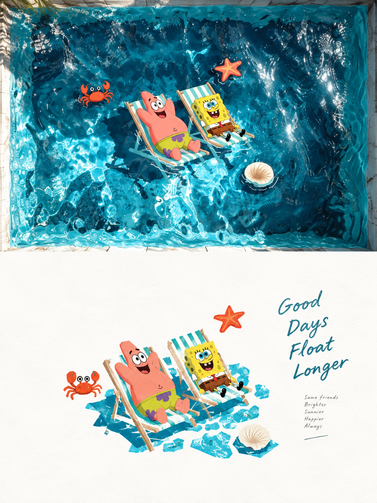
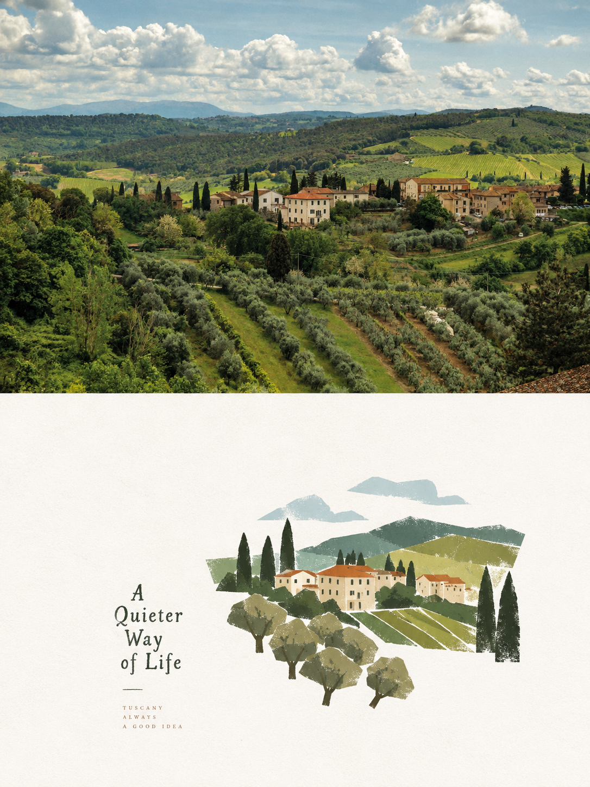
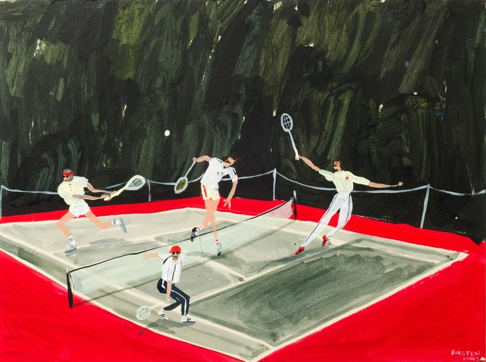
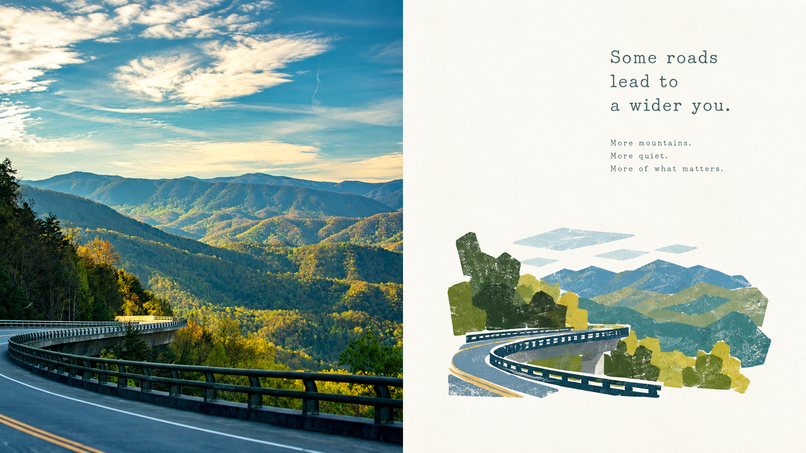
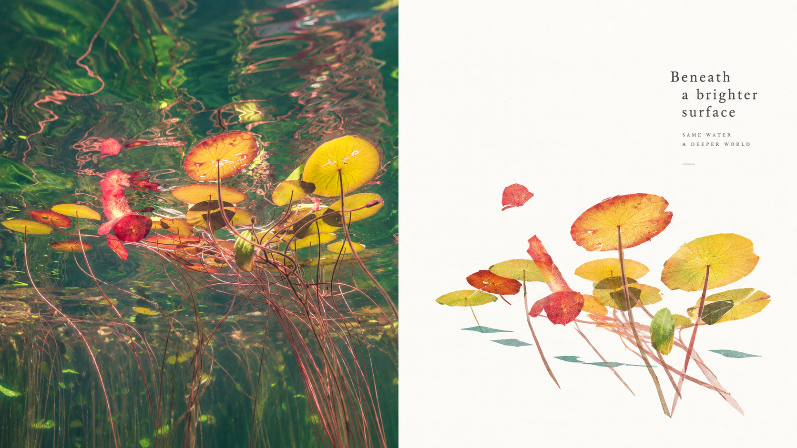
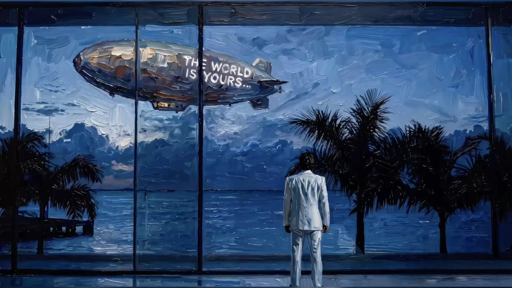

<div align="center">

# XXD Panel 214｜固有色を活かす粗い切り絵小品

**写真を、広い白紙に置いた、本来の色を残す粗い切り絵の小さなイラストにします。**

<a href="README.md">简体中文</a> · <a href="README.en.md">English</a> · <strong>日本語</strong> · <a href="README.ko.md">한국어</a> · <a href="README.ar.md">العربية</a>

</div>

<table>
  <tr>
    <td width="50%"></td>
    <td width="50%"></td>
  </tr>
</table>

<p align="center"><sub>上が元の写真、下がこのスタイルで描き直したものです。</sub></p>

## これは何か

Claude Code や Codex などの AI エージェント向け Skill です。写真を 1 枚渡すと、Panel 214 の原文プロンプトに沿って PNG の完成作品を描きます。

- **どんな絵になるか：** 写真を代表するいくつかの記憶点を、硬い縁と面をもつ不規則な幾何形に切り出します。粗い手切りの紙のようで、中はガッシュ、乾いたパステル、色鉛筆の粒子で塗られ、塗り残しや擦れが残ります。図形は全部合わせても画面の一、二割ほどで、小さな島にまとまり、まわりはきれいな白紙です。それぞれの物は本来の色を保ちます。葉は緑、花や果実は赤やピンク、水や空は青。色同士は白で隔てられ、黒はほとんど使いません。余白には手刷りの風合いがある小さな文字が少し入ります。
- **キーワード：** 粗い切り絵の縁 · 多面的な幾何形 · 乾いた粒子の彩色 · 本来の固有色 · 小さな視覚の島
- **作れるもの：** 上下比較（上に写真、下にデザイン）、左右比較、デザインのみ、またはスマホ／タブレット／PC／ウォッチの壁紙セット。複数選択でき、比率やピクセル数も自由です。
- **これは違う：** フィルターでもテンプレートでもありません。毎回あなたの写真から描き直し、写真 1 枚ごとに独立したタスクです。

## 3 ステップで始める

**1. インストール。** Claude Code、Codex など Skills 対応のエージェントで使えます：

```bash
npx skills add https://github.com/nevertoday/xxd-panel-214 --skill xxd-panel-214
```

インストール後、エージェントのセッションを開き直してください。このリポジトリを `git clone` して `~/.claude/skills/xxd-panel-214` または `~/.codex/skills/xxd-panel-214` にリンクしても使えます。

**2. エージェントが画像を生成できるか確認。** この Skill 自体は画像モデルを持たず、エージェントの画像生成（GPT Image 2 推奨）を使います。

- Codex は内蔵の画像生成が有効ならそのまま使えます。
- Claude Code など内蔵の画像生成がないエージェントは、OpenAI 互換の画像 API が必要です。5 分ほどで設定できます：[画像生成の設定](#画像生成の設定)。

わからなければそのまま試してください。生成できない場合は、作業を始める前に Skill が止まって知らせます。

**3. 写真を送って、ひとこと：**

> xxd-panel-214 でこの写真を 3:4 の上下比較ポスターにして、日本語のタイトルを付けて。

指示がそろっていればすぐ生成し、足りない点（レイアウト、比率、文字）は 1〜2 問ほど質問します。完成した PNG は `~/Desktop/xxd/xxd-panel-214/` の新しいフォルダに保存されます。

## 向いている写真

**向いている**

- 色の違う物がいくつかある日常の場面：ベランダの鉢植え、果物かご、朝食のテーブル、海辺の一角
- 形がシンプルな一つの対象：鳥、自転車、グラスの飲み物
- ライフスタイル誌の小さな挿絵や記事のカットにしたい写真

**あまり向いていない**

- もともと灰色っぽく単調な写真（この作風は物の生き生きした色に頼ります）
- なめらかな曲線や精密な細部が大事な対象：顔のアップ、ジュエリー、精密機械
- 統一したフィルター調、にじむ水彩、黒く太い輪郭線を求める場合

## サンプル

下の画像はすべて、この Skill が写真 1 枚から作った完成作品です。上下比較と左右比較では別の写真を使っています。

### 上下比較：上が写真、下がデザイン

<table>
  <tr>
    <td width="50%"></td>
    <td width="50%"></td>
  </tr>
  <tr>
    <td width="50%"></td>
    <td width="50%"></td>
  </tr>
</table>

### 左右比較：左が写真、右がデザイン

<table>
  <tr>
    <td width="50%"></td>
    <td width="50%"></td>
  </tr>
  <tr>
    <td width="50%"></td>
    <td width="50%"></td>
  </tr>
</table>

## こう言えば OK

パラメータを覚える必要はありません。そのまま伝えてください：

| やりたいこと | こう言う |
|---|---|
| 上下比較 | 3:4 の上下比較にして |
| 左右比較 | 16:9 の左右比較で、左に写真 |
| デザインのみ | 写真なしでデザインだけ、9:16 縦長 |
| 壁紙セット | スマホ、タブレット、PC、ウォッチの壁紙を統一感のあるセットで |
| 複数の比率 | 同じ写真で 1:1、3:4、16:9 を 1 枚ずつ |
| 自分の文字 | タイトルは「風の通り道」、一字も変えないで |
| 文字なし | 文字は一切入れないで |
| 文字の言語 | 文字は英語で |
| フォルダごと | このフォルダの写真を全部上下比較にして |
| 前回と同じ | 前回の設定で |

コマンドラインが好みなら、パラメータは上と一対一で対応します：

```text
/xxd-panel-214 photo.jpg --mode top-bottom --size 3:4 --text prompt --locale ja-JP
/xxd-panel-214 photo.jpg --mode design-only --size 9:16 --text none
/xxd-panel-214 ./photos --mode left-right --size 16:9 --text prompt --locale en-US
```

すべてのパラメータは[パラメータ一覧](#パラメータ一覧)にあります。

## よくある質問

**元の写真は必ず入りますか？** いいえ。「デザインだけ」や壁紙なら、画面全体がデザインになります。

**文字は誰が書くのですか？** 既定では画像モデルが写真を見て書き、あなたは言語だけを選びます。自分の文字を指定すれば一字も変えずに使い、文字なしにもできます。事実に見える情報（地名、日付、数字）は、あなたが渡したものか写真に写っているものだけを使い、作りません。

**気に入らなかったら？** 「もう 1 枚」と言ってください。前の結果を直すのではなく元の写真から描き直すので、毎回違う結果になります。

**まとめて処理すると混ざりませんか？** 混ざりません。写真ごとに個別に生成し、ほかの写真の色、文字、構図を借りません。設定は一括で 1 回だけ聞きます。

**写真はどこに送られますか？** エージェントが使う画像モデルにだけ送られます。Skill はほかへアップロードせず、接続先やキーも表示しません。

**ほかの Panel との関係は？** XXD Panel は番号ごとに 1 つのスタイルで、互いに独立しています。好きなものだけ入れてかまいません。写真に合うスタイルを AI に選ばせたい、複数を比べたいときは、カタログ [xxd-panel-all](https://github.com/nevertoday/xxd-panel-all) を使ってください。

## 原文プロンプト

このスタイルは小小東が書いた[原文プロンプト](references/original-prompt/zh-CN.md)（中国語）だけで決まります。Skill はあなたが選んだレイアウト、サイズ、文字の設定を末尾に足すだけで、要約・翻訳・書き換えはしません。

参考訳（読むためのもので、画像生成には使いません）：[English](references/original-prompt/en.md) · [日本語](references/original-prompt/ja.md) · [한국어](references/original-prompt/ko.md) · [العربية](references/original-prompt/ar.md)

## 画像生成の設定

`gpt-image-2`（または互換モデル）を提供する OpenAI 互換 API とその API キーが必要です。次の手順は別の設定ファイルを作るので、Codex 本体の設定には影響しません：

```bash
mkdir -p ~/.xxd-imagegen
cat > ~/.xxd-imagegen/config.toml <<'EOF'
model_provider = "image"

[model_providers.image]
base_url = "https://api.openai.com/v1"   # または互換エンドポイント
env_key = "XXD_IMAGE_API_KEY"
EOF

# ~/.zshrc か ~/.bashrc に書き、エージェントからも読めるようにする
echo 'export XXD_IMAGEGEN_CODEX_DIR=~/.xxd-imagegen' >> ~/.zshrc
echo 'export XXD_IMAGE_API_KEY=あなたのキー' >> ~/.zshrc
```

ターミナルとエージェントを開き直してから、この Skill のフォルダで一度確認します：

```bash
python3 scripts/configured_imagegen.py probe
```

`"ok":true` なら成功です。結果は使えるかどうかだけで、接続先やキーは表示されません。Codex がすでに互換 API で画像を生成できるなら、この手順は不要です。

## パラメータ一覧

| パラメータ | 値 |
|---|---|
| `--mode` | `top-bottom` 上下比較 · `left-right` 左右比較 · `design-only` デザインのみ · `wallpaper-pack` 4 端末の壁紙；複数選択可 |
| `--size` | `auto` おすすめ · `source` 写真に合わせる · `1:1` `3:4` `4:3` `4:5` `5:4` `2:3` `3:2` `9:16` `16:9` `21:9` `5:7` `7:5` · ピクセル指定（例 `2160x3840`）；複数選択可 |
| `--text` | `prompt` 写真から書く · `exact` あなたの文字（`--copy "…"` と併用） · `none` 文字なし |
| `--locale` | 文字の言語。例：`zh-CN` `en-US` `ja-JP` `ko-KR` `ar` |
| `--wallpaper` | `linked` 統一感のあるセット · `independent` 4 枚それぞれ独立 |
| `--wallpaper-size` | 端末ごとのピクセル。例：`phone=1440x3200,desktop=3840x2160` |
| `--out` | 出力先のルートを変更（既定は `~/Desktop/xxd/xxd-panel-214/`） |
| `--prefs` | `last` 前回どおり · `edit` 前回から変更 · `new` 選び直す · `off` 今回は記録しない · `clear` 記録を消す |

- 値がそろっていれば質問せず、足りないものだけを聞きます。`photo.jpg` の代わりにフォルダを渡すと一括処理になります。
- 組み合わせは 1 枚ずつ生成します。2 モード × 3 サイズ = 6 枚で、どれも切り抜きではなくキャンバスごとに構図を組み直します。
- 比較画像は正確に 50:50 です。通常はモデルがデザイン側だけを描き、スクリプトが元の写真をそのまま隣に並べるので、境目は中央で写真も変わりません。
- ファイル名は `source-001-street-top-bottom-3x4-1152x1536.png` のような形式で、すべて 1 つのタスクフォルダに平置きされます。
- 記録するのはレイアウト、サイズ、文字の方式と言語だけで、写真、文字、キーは残しません。

<!-- xxd-readme-ads:start -->
## XXD について

XXD は Xiaoxiaodong のブランド名略称です。本プロジェクトの作成・管理：[@xiaoxiaodong01](https://x.com/xiaoxiaodong01)。

## Xiaoxiaodong マルチプラットフォーム会員 · 年額 CNY 699

> **広告表示：** 以下のQRコード、会員および有料サービスのリンクはXXDの広告情報です。スキャンや購入は任意であり、オープンソースの利用には影響しません。

年額会員ひとつで、**Knowledge Planet＋XXD会員プロンプトライブラリ＋すべてのGeneral Skills会員**の3つを利用できます。別々に購入する必要はありません。

<!-- xxd-panel-command-system:start -->

### Skills の連携方法

| 区分 | 含まれるもの | 役割 |
|---|---|---|
| **General** | [`xxd-panel-all`](https://github.com/xiaoxiaodong-ai/xxd-panel-all) | 利用可能な番号付きSkillsを検出し、画像・テーマ・用途から推薦し、複数スタイルや一括タスクを整理します。 |
| **Soldier** | `xxd-panel-NNN` | 各番号が固有の原文プロンプトと美学に従い、Generalから割り当てられた具体的な作業を完成させます。 |

<!-- xxd-panel-command-system:end -->

### 会員の内容

1. **WeChatでの一対一AI学習・プロジェクト相談**
   下のQRコードからXiaoxiaodongのWeChatを追加し、AI学習、ツール、実際のプロジェクトについて一対一で相談できます。代表的な質問は会員向けコンテンツに整理されます。
2. **継続更新する会員プロンプトライブラリ**
   [XXD会員プロンプトライブラリ](https://vip.xiaoxiaodong.ai/)には現在約3.2万件のプロンプトがあり、10万件超を目標に継続して拡充します。
3. **すべてのGeneral Skillsと利用サポート**
   ひとつの会員で全General Skillsを利用でき、使い方に困ったときは案内やQ&Aを受けられます。
4. **必要性の高い要望を優先**
   会員から寄せられた頻度と必要性の高いプロンプトやSkillsは、優先して検討・開発します。

### 開設方法

- [会員サイトから自分で開設](https://vip.xiaoxiaodong.ai/)できます。
- または下のQRコードからXiaoxiaodongのWeChatを追加し、一対一で開設サポートを受けられます。

<p align="center"><a href="https://xiaoxiaodong.pages.dev/assets/wechat-qr.png"></a></p>
<!-- xxd-readme-ads:end -->

## ライセンス

本プロジェクト（Skill、プロンプト、スクリプト、文書、付属サンプル画像を含む）は **PolyForm Noncommercial License 1.0.0** の下で提供されます。完全な法的条文は [LICENSE](LICENSE)、公式ページは <https://polyformproject.org/licenses/noncommercial/1.0.0> を参照してください。

分かりやすく言うと：

- 個人は学習、研究、実験、テスト、趣味のプロジェクト、私的娯楽に使用できます。慈善団体、教育機関、公的研究・安全・保健機関、環境保護団体、政府機関も使用できます。
- **非商業目的**であれば、使用、複製、変更、派生物の作成、共有が可能です。共有時には本ライセンス（または上記リンク）と、作者が示したすべての `Required Notice:` 文を添付する必要があります。
- 商用製品・サービス、有料納品、アクセス権やライセンスの販売、商業利用につながることが予想される用途には使用できません。商用利用には著作権者から別途書面による許可を得てください。
- 本契約が付与するのは明記された著作権ライセンスと限定的な特許ライセンスだけです。商標、ブランド名、その他明記されていない権利は付与されず、ライセンスを第三者へ再許諾することもできません。
- 書面で違反通知を受けた場合、32 日以内に遵守状態へ戻り、実際の是正措置を取らなければライセンスは直ちに終了します。特許侵害を書面で主張した場合も特許ライセンスが終了します。
- 内容は法律が認める範囲で「現状のまま」提供され、保証はありません。利用に伴うリスクと損失は利用者が負います。
